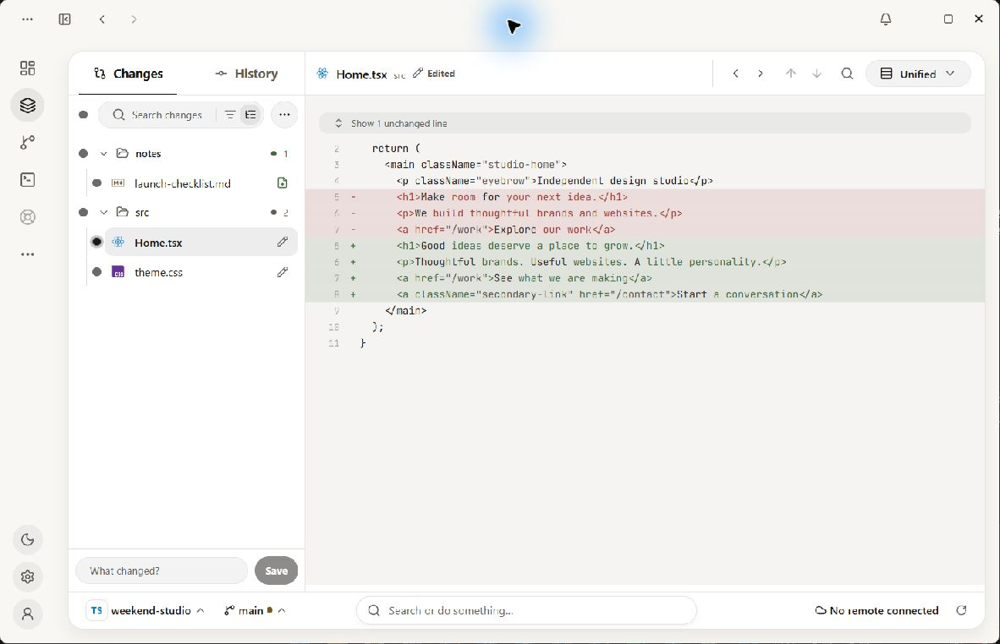
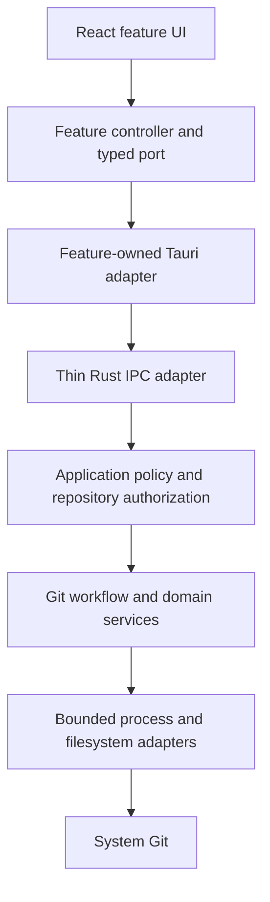

<div align="center">
  <picture>
    <source media="(prefers-color-scheme: dark)" srcset="docs/readme/gitodile-mascot-dark.svg" />
    
  </picture>

  <h1>GitOdile</h1>

  <p><strong>The Git client for humans and their agents.</strong></p>
  <p>A calmer way to understand your project, save your work, and collaborate.</p>

  <p>
    <a href="https://github.com/martinezelx/gitodile-desktop/actions/workflows/ci.yml"></a>
    <a href="https://github.com/martinezelx/gitodile/releases/latest"></a>
    <a href="LICENSE"></a>
    <a href="#architecture"></a>
  </p>

  <p>
    <a href="https://github.com/martinezelx/gitodile/releases/latest">Downloads</a> ·
    <a href="#what-you-can-do">Features</a> ·
    <a href="#architecture">Architecture</a> ·
    <a href="#roadmap">Roadmap</a> ·
    <a href="#frequently-asked-questions">FAQ</a> ·
    <a href="#development">Development</a> ·
    <a href="https://github.com/martinezelx/gitodile/issues">Report an issue</a>
  </p>
</div>

---

GitOdile is a local-first desktop Git client for learners, AI-assisted builders,
designers, writers, and developers who want to see what changed and understand
what happens next. Review your work, save a version, and publish changes through
guided workflows that explain their consequences and preserve recovery paths.

The goal is simple: **See everything. Undo anything.** Recovery is being built
one workflow at a time; the full recovery center is still on the roadmap.

> **Early development.** Public builds are testing releases. Windows and Linux
> installed-update qualification is still in progress. Windows builds do not yet
> have Authenticode signing; macOS packages are planned after `1.0.0`.

<picture>
  <source media="(prefers-color-scheme: dark)" srcset="docs/readme/gitodile-changes-dark.jpg" />
  
</picture>

<p align="center"><em>Review changes before saving. GitOdile 0.5.0 development build, shown with a sample project.</em></p>

## Why GitOdile?

- **Start with intent.** Save a version, publish changes, or try an idea on a
  branch. Learn Git terminology as you need it.
- **See the consequences.** Review plans before publishing or changing history,
  with clear explanations of what affects files, saved work, or a remote.
- **Keep a way back.** Discarded work has persistent local recovery records and
  Undo. Supported branch cleanup and integration flows keep recovery points.
- **Stay in control.** Local workflows need no hosting account. Remote access
  uses your existing Git credentials or a connection you choose.
- **Keep the technical truth.** Branches, diffs, history, commands, hooks, and
  signing stay part of the workflow, with details available when you need them.

## What you can do

### Your everyday workflow

| 1. Review changes | 2. Save a version | 3. Publish changes |
| --- | --- | --- |
| See which files changed and read the diff before deciding what to keep. | Choose all or selected files and give this moment a meaningful name. Your saved version stays local. | Review the plan, then send your saved versions to the project's remote when you are ready. |

### More ways to work

| Workflow | Available today |
| --- | --- |
| **Start a project** | Open an existing project, clone a remote, or safely create a local project without replacing existing files. |
| **Understand changes** | Inspect live file status, syntax-colored diffs, and Markdown previews with added and removed blocks. |
| **Save your work** | Save all or selected files as a version, with a preview and index protection. Git hooks run by default; commit signing follows your Git configuration. |
| **Collaborate** | Check for project changes, combine non-overlapping updates, and publish through confirmed plans with recovery points. |
| **Manage branches** | Create, switch, rename, and clean up finished branches with safety checks and recovery references. |
| **Explore history** | Browse one branch or all branches, inspect saved versions, and see what is local or published. |
| **Recover discarded work** | Undo a discard or browse stored recovery copies and see which ones can still be restored. |
| **Use familiar tools** | Run supported Git commands in a project-scoped console; changes require confirmation by default. |
| **Make it yours** | Choose light or dark themes, English or Spanish, date and number formats, and keyboard-driven navigation. |

### Hosting connections

Connect **GitHub**, **GitLab**, **Bitbucket Cloud**, or **Azure Repos**, including
GitHub Enterprise Server and GitLab Self-Managed instances. Choose an account
per project without changing your commit identity or SSH configuration.

GitHub, GitLab, and Bitbucket offer repository browsing. Azure Repos uses an
organization-scoped personal access token and a pasted clone URL. Native token
connections use the operating system's secure credential store without a
plaintext fallback; optional browser connections use `gh` or `glab` and share
those tools' local sessions.

Local Git workflows remain provider-neutral. Hosting integrations have different
permission and qualification limits; see the
[architecture guide](docs/ARCHITECTURE.md#platform-and-security-constraints)
and the app's connection guidance.

## Downloads and platform status

Get testing builds from the **[public releases](https://github.com/martinezelx/gitodile/releases)**.
This repository contains the desktop source; downloads, release notes, and user
issues live in [martinezelx/gitodile](https://github.com/martinezelx/gitodile).

| Platform | Package | Status |
| --- | --- | --- |
| Windows x86-64 | Per-user NSIS installer (`.exe`) | Testing builds available; installed-update qualification pending. Authenticode is deferred, so Windows may show an unknown-publisher warning. |
| Linux x86-64 | AppImage | Testing builds available; installed-update qualification pending. |
| macOS | No published package | Delivery and qualification planned after `1.0.0`. |

Updates use Tauri updater signatures and one release channel. GitOdile checks
for updates at startup by default, but downloading and installing require your
action. Updater signatures and operating-system publisher signing are separate;
see the [code-signing policy](docs/CODE_SIGNING_POLICY.md).

## Versions

Recent published releases are listed below. Each tag opens its full release notes
and downloads; source tags live in
[this repository](https://github.com/martinezelx/gitodile-desktop/tags).

| Tag | Released | Highlights |
| --- | --- | --- |
| [`v0.4.1`](https://github.com/martinezelx/gitodile/releases/tag/v0.4.1) | October 28, 2026 | Azure Repos connections, Markdown previews, persistent notifications, and interface and performance improvements. |
| [`v0.4.0`](https://github.com/martinezelx/gitodile/releases/tag/v0.4.0) | October 22, 2026 | Hosting accounts, project discovery, integration previews, branch cleanup, and richer history. |
| [`v0.3.0`](https://github.com/martinezelx/gitodile/releases/tag/v0.3.0) | October 1, 2026 | Guided everyday workflow, Git console, mascot and themes, and a single update channel. |

The latest published version is reflected in the badge above. Planned versions
below describe upcoming scope, not available downloads.

## Architecture

GitOdile uses **React + TypeScript + Vite** for the interface, **Tauri 2** for
the desktop shell, and **Rust** for Git operations and platform-sensitive work.
It runs the **system Git executable**, preserving compatibility with existing
repositories, credentials, hooks, and signing tools.



<details>
<summary>Module map and safety boundaries</summary>

| Area | Responsibility |
| --- | --- |
| `src/app/` | App composition, navigation, registered screens, and shared orchestration. |
| `src/features/` | Feature-owned UI, controllers, domain types, typed ports, and Tauri adapters. |
| `src/runtime/` | Project-scoped state, freshness, invalidation, and screen lifecycle contracts. |
| `src/shared/` | Reusable UI primitives, design tokens, and shared utilities. |
| `src-tauri/src/` | Native authorization, Git workflows, recovery, credentials, bounded execution, and platform services. |
| `docs/adr/` | Architectural decisions, their rationale, and trade-offs. |

Safety is enforced at the native boundary: Rust validates inputs, authorizes
project sessions, coordinates reads and mutations, and revalidates operation
plans before execution. Git arguments are passed directly to processes, without
constructing shell commands from user input.

Repository-sized lists are virtualized and native payloads are bounded. Screens
render cached snapshots, refresh through explicit invalidation, and suspend
background work while hidden.

Read the [architecture guide](docs/ARCHITECTURE.md) and
[frontend feature guide](docs/architecture/frontend-feature-guide.md) for
ownership rules, contracts, and extension points.

</details>

## Roadmap

The next milestone is a trustworthy `1.0.0`: complete the everyday project
workflow with understandable consequences and a visible way back.

| Milestone | Focus | Planned outcome |
| --- | --- | --- |
| **0.5.0** | Collaboration | Resolve overlapping changes and bring local branches or diverged project changes together safely. |
| **0.6.0** | Recovery | A recovery center, safe restoration of saved versions, and setting unfinished work aside. |
| **0.7.0** | Release hardening | Credential diagnostics, accessibility and large-project audits, and Windows/Linux release and update qualification. |
| **1.0.0** | Everyday workflow | Ship the validated core workflow, from project creation through collaboration and recovery. |
| **After 1.0.0** | A safety net for people and agents | Automatic checkpoints, external-activity visibility, session recovery, deeper hosting workflows, and macOS delivery. |

These are capability milestones, not delivery dates. Agent-era features follow
the core `1.0.0` workflow. See the [full roadmap](docs/ROADMAP.md),
[approved work](work/README.md), and
[product strategy](docs/PRODUCT_STRATEGY.md).

## Frequently asked questions

### Do I need a GitHub account?

No. You can open local projects, inspect changes, save versions, and manage
branches without a hosting account. Remote workflows use your existing Git
credentials or a hosting connection you choose.

### Does GitOdile work with existing repositories?

Yes. Open an existing Git project directly. GitOdile uses standard Git
repositories and works alongside your editor, terminal, and coding agents.
Your repository does not need to be converted to a proprietary format.

### Does GitOdile replace Git?

GitOdile provides a desktop interface over your installed Git executable.
Git 2.23 or newer is required; the app can help diagnose a missing or unusable
installation. Node.js and Rust are only needed when building from source.

### What can I recover today?

Discarded files have persistent local recovery records and Undo. Supported
branch cleanup and integration operations also create recovery points.
Recovery depends on the operation and the current project state: the slogan
does not mean every change made by every tool can already be undone.
The recovery center and restoring earlier saved versions are planned for `0.6.0`.

## Development

To build GitOdile yourself, expand the setup instructions below. For testing
builds you can install directly, see [Downloads and platform status](#downloads-and-platform-status).

<details>
<summary>Build, run, and check GitOdile locally</summary>

### Prerequisites

- **Node.js `>=24`** and **pnpm** (`pnpm@11.17.0`, pinned in `package.json`).
- **Rust stable**, including `rustfmt` and `clippy`.
- **Git 2.23+** available on the system.
- Platform dependencies: Microsoft C++ Build Tools and WebView2 on Windows,
  Xcode Command Line Tools on macOS, or WebKitGTK 4.1 and the required
  distribution packages on Linux. See the
  [Tauri prerequisites](https://v2.tauri.app/start/prerequisites/).

### Run locally

If your Node.js installation does not include Corepack (Node.js 25 and later
do not bundle it), [install Corepack](https://github.com/nodejs/corepack#installation)
before running `corepack enable`. The project's `packageManager` field selects
the required pnpm version.

```bash
git clone https://github.com/martinezelx/gitodile-desktop.git
cd gitodile-desktop
corepack enable
pnpm install --frozen-lockfile
pnpm run tauri dev
```

For frontend-only development, run `pnpm run dev` and open
`http://localhost:1420`. The shared style gallery is at
`http://localhost:1420/gallery.html`; it works without Tauri or a project.

### Checks and builds

```bash
pnpm run check         # Complete repository gate
pnpm run tauri build   # Local desktop bundle; not a signed public release
```

The complete gate checks documentation, architecture boundaries, TypeScript,
frontend tests and production build, Rust formatting, Clippy, and Rust tests.
Use `check:docs`, `check:architecture`, `check:frontend`, or `check:rust` while
iterating. Lockfiles are authoritative for resolved dependency versions.

Public builds follow the [signed-build](docs/release/signed-builds.md) and
[publishing](docs/release/public-publishing.md) runbooks and require
`pnpm run check:publication`. Releases use plain `X.Y.Z` versions on one channel;
the merge-driven pipeline creates tags from approved release pull requests.

</details>

## Bug reports and support

GitOdile is developed and maintained by its author. External code contributions
and pull requests are not currently accepted.
See the [contribution policy](CONTRIBUTING.md).

- **Bug reports:** use the
  [public issue tracker](https://github.com/martinezelx/gitodile/issues).
  The app's **More actions → Report an issue** prepares a report you can review
  before submitting, without project paths, code, or remote URLs.
  Search existing issues first. Include your GitOdile version, operating system,
  steps to reproduce, and what you expected versus what happened. Attach a
  screenshot if it helps, after removing private information. Never include
  access tokens, passwords, or private source code in a public report.
- **Security vulnerabilities:** open a
  [private security report](https://github.com/martinezelx/gitodile/security/advisories/new).
  See [SECURITY.md](SECURITY.md) for the security policy.
- **Privacy:** local workflows keep repository content on your device. Remote
  Git operations, hosting connections, and update checks contact their services;
  see the [privacy policy](docs/PRIVACY.md).

## Documentation

| Guide | What it covers |
| --- | --- |
| [Product strategy](docs/PRODUCT_STRATEGY.md) | Audience, positioning, and the long-term direction. |
| [Design direction](DESIGN.md) | Visual language, interaction, content, and accessibility. |
| [Architecture](docs/ARCHITECTURE.md) | Current system boundaries and extension rules. |
| [Decision records](docs/adr/) | Why significant technical and product decisions were made. |
| [Roadmap](docs/ROADMAP.md) | Capability milestones and release gates. |
| [Work index](work/README.md) | Approved scope, acceptance criteria, and completed work. |
| [Console shortcuts](docs/console-shortcuts.md) | Built-in shortcuts and the Git commands they run. |

## License

Copyright © 2026 Luis M. Martínez. Licensed under
**GNU AGPL-3.0-only**; see [LICENSE](LICENSE).

The GitOdile name, mascot, logo, application icon, and visual identity are
subject to separate brand rights. The software license does not grant rights
to use them. See [third-party notices](THIRD_PARTY_LICENSES.md) for attribution.
